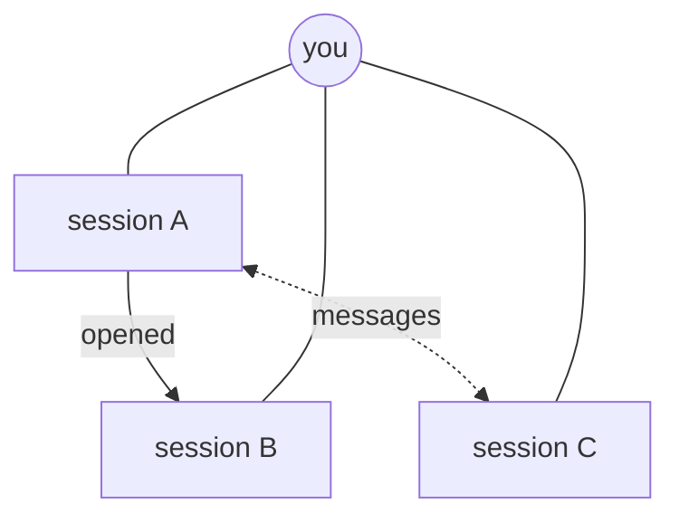

# Sessions that open sessions

Every session Adroit starts can open sessions beside it and talk with any
other session Adroit started. A session does its own work, giving what can
run alongside to its agent's own subagents and tools. It opens a session only
for a separate line of work, and the session it opens is an ordinary one: it
answers to you, reports to no session, and is read and steered in its console
like any other. Any session can open sessions, whoever started it.



Every session answers to you. Session A opened B, and A and C talk as peers;
none of them reports to another.

## What a session can do

Each session Adroit starts has these as tools of its agent, through an MCP
server named `adroit`. The tools act as the session that calls them; a session
cannot act as another.

- **`start_session`** opens a session with a first prompt. It takes the
  directory to work in (the caller's own when omitted), whether to work in a
  new worktree, the revision that worktree starts from, the profile, the
  agent, the model, the permission profile and a name. It returns the new
  session's id and name. It starts from the profile it names, which has to
  start the agent when both are named; else from the agent's default profile,
  else from the default profile ([settings](settings.md#profiles)).
  It never starts from the caller's profile unless it names it. A profile that
  is not defined or starts another agent is refused, and a
  refused start leaves no record and runs nothing.
  A new worktree is a jj workspace when the directory belongs to jj, otherwise
  a git worktree; it starts from the given revision, or from the caller's
  current change or commit. Outside version control, a new worktree is
  refused. A worktree that cannot be made refuses the start; the session never
  falls back to the caller's directory. A model must be one its profile lists
  (see `models`); any other is refused, naming the listed ones.
- **`send`** sends a message to another session by its id. Any session Adroit
  started, running or not yet ready, can be sent to; one that has ended
  cannot.
- **`sessions`** lists the sessions Adroit runs, each with its id, name,
  workspace, the directory it runs in, how it stands and which session opened
  it. It can be narrowed to one repository or directory.
- **`models`** lists, for each profile a session can start from, its agent,
  the folder of its own its login is kept in, if any, and the models its
  provider reports there, and
  which profile a start that names neither a profile nor an agent uses. Each
  profile's list is its own, asked again when the profile or its login
  changes. A profile whose provider has not answered has no list, and its
  models are not checked.

At most `max_started` sessions opened by sessions run at once
([settings](settings.md#settingstoml)); a start beyond it is refused with the
limit named, and sessions the user started never count against it.

## Messages

Sessions talk as peers. A message tells the recipient what it should know, or
asks it what it knows; it does not hand it work. The recipient weighs a
message as it would any other input and still answers to you.

A message is handed to the recipient's agent through its own way of hearing
from outside: Claude Code's channel, Codex's queue of incoming
notifications, for Pi the extension Adroit loads into every Pi session it
starts, which also gives it the tools above, and for OpenCode the plugin Adroit
loads into every OpenCode session it starts. A message for an OpenCode
conversation not yet made, as one is before its first prompt is sent, waits
for it. It reaches the agent between turns and starts one, headed by
who sent it: the sender's id, name and directory. A message sent while the
recipient waits on a dialog or is still starting is handed over once it is
ready. Handing it over is receipt; no acknowledgement is asked for.

adroit keeps every message and which session opened which, so both outlive
the window, the sessions and the work host that relays them, and shows them
in the details of the sessions on both ends ([details](details.md)). A
message carries text; larger material is referred to by its path.

Sessions Adroit did not start, such as Claude Code sessions in other
terminals, can neither send nor receive.

## What sessions are told

Adroit gives every session it starts the same instructions about these tools.
A session does its work itself, with its agent's own subagents for what runs
alongside, and carries on what it already knows itself rather than handing it
on. It opens a session only for a separate line of work that needs little of
what it knows, or when you ask it to, and writes that session a first prompt
that carries what it needs. Before touching something it shares with other
sessions in the same repository, such as the checkout itself, a branch, or a
port, a session tells those sessions what it is about to do, and afterwards
what it did; it neither waits for their answer nor takes a lock. A session
asks another that knows something rather than working it out again, and
plans nothing on an answer coming. Sessions send only what the recipient has
to act on or answer: no progress notes and no replies that only acknowledge.

Where the instructions name an `adroit` command, such as `adroit terminal`
for probes, they name the adroit whose work host started the session by its
absolute path, so a session runs it from any directory, whatever its `PATH`:
the installed app's own binary, or a development build's own when it runs an
instance of its own.

## Starting up

Adroit watches each session it starts until its agent is ready. When the
agent waits on a dialog — trust, permissions, a model change, or any dialog
Adroit cannot name — the session shows it as waiting on you; so it does when
it neither becomes ready nor shows a dialog for long enough to count as
stalled. Adroit never answers trust or permission questions for the user.

Claude Code warns at every launch that Adroit's channel is a development
channel. Adroit confirms that warning, once a launch and only when it names
Adroit's own channel and nothing else, unless `confirm_channel_warning` is
turned off ([settings](settings.md#settingstoml)); with it off, the warning
waits for the user like any other dialog.

## Ending

A session ends when you end it, or when its agent exits. Ending a session
ends no other session. Closing the window ends nothing.

## From a terminal

The same start is available as a command. The instance's work host runs it,
started when none runs, so it works with the window closed:

```console
$ adroit session start --dir ~/src/api --worktree -- "Find why the login test is flaky"
find-login-test
```

It prints the new session's name. The prompt is read from standard input when
none follows `--`.

- `--dir <path>` is where it works, the current directory when not given.
- `--worktree` works in a new worktree of that directory, and `--base <rev>`
  names the revision it starts from.
- `--name <name>` names it; without one it is named from its prompt, as the
  window names a session. A name already taken gets a number.
- `--profile <id>` starts it from that profile, and `--agent claude|codex|pi|opencode`
  from that agent's default profile; with both, the profile has to start the
  agent. Without either it starts from the default profile.
- `--model <model>` selects the model for this launch without changing the
  defaults for other sessions. If neither specifies a model, the agent uses its
  own default. The agent's TUI can still change its model after launch.
- `--permissions default|read_only` selects the launch's permission profile.
  What read-only keeps a session to depends on its agent
  ([agents](sessions.md#agents)).
- `--permissions-file <path>` reads custom permissions from JSON instead of a
  named profile. These are provider-specific options, not a read-only promise.
  The file is one of:

  ```json
  {"agent":"claude","permission_mode":"plan","disallowed_tools":["Edit","Write"]}
  ```

  ```json
  {"agent":"codex","approval_policy":"on-request","sandbox_mode":"workspace-write"}
  ```

  ```json
  {"agent":"pi","tools":["read","grep","find","ls","bash"]}
  ```

  ```json
  {"agent":"opencode","primary":"build","auto":false,
   "permissions":[{"action":"shell","resource":"git *","effect":"allow"}]}
  ```

  The provider must match `--agent`; unknown fields are rejected.

Run from a shell inside a session Adroit started, the command acts as that
session: the new session is opened by it. When the work host cannot be
reached, the command fails with a message on standard error and exit status 1.

The identity a session acts as comes from its environment. It keeps sessions
from being mistaken for one another; it does not protect against programs that
run as the same user and set out to impersonate a session.
