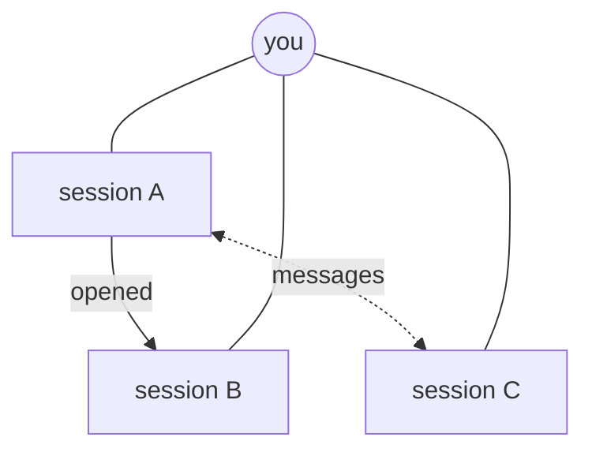

# Sessions that open sessions

Every session Adroit starts can open sessions beside it and talk with any
other session Adroit started. A session does its own work, giving what comes
back to it to its agent's own subagents and tools. It opens a session for a
line of work you will want to steer yourself, and the session it opens is an
ordinary one: it answers to you, reports to no session, and is read and
steered in its console like any other. Any session can open sessions, whoever started it.



Every session answers to you. Session A opened B, and A and C talk as peers;
none of them reports to another.

## What a session can do

Each session Adroit starts has these as tools of its agent, through an MCP
server named `adroit`. The tools act as the session that calls them; a session
cannot act as another.

- **`start_session`** opens a session with a first prompt. It takes the
  directory to work in (the caller's own when omitted), whether to work in a
  new worktree, the revision that worktree starts from, the profile, the
  agent, the model, the permission profile, a name, and whether to start it
  in the background. It returns the new session's id,
  [code](sessions.md#a-sessions-code) and name. A session
  opens in a tab of each window as it appears: with the keys in a window whose
  focused window shows the session that opened it, unless you are typing
  there — writing in the prompt, or passing every key to the console — and
  otherwise behind the tab shown, so what you were looking at and typing into
  stays. One started
  in the background is only listed. It starts from the profile it names, which has to
  start the agent when both are named; else from the agent's default profile,
  else from the default profile ([settings](settings.md#profiles)).
  It never starts from the caller's profile unless it names it. A profile that
  is not defined or starts another agent is refused, and a
  refused start leaves no record and runs nothing.
  A new worktree is a jj workspace when the directory belongs to jj, otherwise
  a git worktree; it starts from the given revision, or from the caller's
  current change or commit. Outside version control, a new worktree is
  refused. A worktree that cannot be made refuses the start; the session never
  falls back to the caller's directory. A start refused or failed after its
  worktree is made removes that worktree again, unless the agent may already
  run on the work machine. A model must be one its profile lists
  (see `models`); any other is refused, naming the listed ones.
- **`send`** sends a message to another session by its code or its id. Any session Adroit
  started, running or not yet ready, can be sent to; one that has ended
  cannot.
- **`request`** asks another session, by its code or its id, for work
  ([requests between sessions](#requests-between-sessions)), and tells whether
  it is taken up as work. Who can be sent to can be asked.
- **`rename_session`** names the caller's own session anew
  ([renaming](sessions.md#renaming-a-session)), and returns the name it
  took, numbered when another session has it. It is refused for a name you
  gave and while renaming is switched off, telling the agent to keep the name.
- **`close_session`** ends the caller's own session a moment after it
  answers, as ending it from Adroit does
  ([sessions](sessions.md#when-a-task-is-done)).
- **`timeline_tasks`** records the plan and progress of the caller's work on
  its timeline ([details](details.md#the-timeline)), as a list of changes
  made in order: `add` a task with its id, the task it is a step of (none for
  a new tree), a title, and optionally a weight (1 when omitted), a status
  (`pending`, `in_progress`, `completed` or `blocked`; `pending` when
  omitted), a description and a note; `update` a task's status, title,
  weight, description or note; `remove` a task with every step under it. A
  change that cannot be made, such as one naming a task that does not exist,
  is skipped and named in the answer, and the others are made; a call none of
  whose changes can be made is refused and leaves the timeline as it was. It
  returns every tree as it now stands.
- **`timeline`** returns every tree of the caller's timeline with its tasks'
  statuses, weights and notes, and each tree's progress.
- **`sessions`** lists the sessions Adroit runs, each with its id, code, name,
  workspace, the directory it runs in, how it stands and which session opened
  it. It can be narrowed to one repository or directory.
- **`models`** lists, for each profile a session can start from, its agent,
  the folder of its own its login is kept in, if any, and the models its
  provider reports there, and
  which profile a start that names neither a profile nor an agent uses. Each
  profile's list is its own, asked again when the profile or its login
  changes. A profile whose provider has not answered has no list, and its
  models are not checked.

However many sessions run, a session can open one more. You can switch
sessions opening sessions off ([settings](settings.md#settingstoml)), and it
is off while the settings cannot be read: a start is then refused, telling the
agent to carry on itself or ask you, and the sessions already running go on.
An earlier settings file that capped how many sessions opened by sessions run
at once still loads, and the cap is dropped.

## Messages

Sessions talk as peers. A message tells the recipient what it should know, or
asks it what it knows; it does not hand it work, which a
[request](#requests-between-sessions) does. The recipient weighs a
message as it would any other input and still answers to you.

A message is handed to the recipient's agent through its own way of hearing
from outside: Claude Code's channel, Codex's queue of incoming
notifications, for Pi the extension Adroit loads into every Pi session it
starts, which also gives it the tools above, and for OpenCode the plugin Adroit
loads into every OpenCode session it starts. A message for an OpenCode
conversation not yet made, as one is before its first prompt is sent, waits
for it. It reaches the agent between turns and starts one, headed by
who sent it: the sender's id, name and directory. A message sent while the
recipient waits on a dialog or is still starting is handed over once it is
ready. Handing it over is receipt; no acknowledgement is asked for.

Adroit keeps every message and which session opened which, so both outlive
the window, the sessions and the work host that relays them, and shows them
in the details of the sessions on both ends ([details](details.md)). A
message carries text; larger material is referred to by its path.

A program outside Adroit asks a session for work too
([requests](#requests)). Sessions Adroit did not start, such as Claude Code sessions in other
terminals, can neither send nor receive.

### Requests between sessions

A session asks another to carry out what you decided or want with a request.
The other takes it up as work when you let the sender ask it, and otherwise is
told it as information, which the sender learns too. A session takes up what
the session that opened it asks, and from no other, nor from those it opened,
until you say so: you let a session ask another, or no longer, in the details
of the one asked ([requests](details.md#components)), at any time. What you
said holds for both sessions as they are resumed or brought back. It also
holds for a request sent but not yet handed over; one already handed over is
not taken back. Nothing Adroit gives a session says it for you. With requests switched off
([settings](settings.md#settingstoml)) every one is told as information.

A request is handed over as a message is, headed as a request from the
session that sent it. It is not your own word: it approves nothing and answers
nothing that waits on you, and before pushing, publishing, deleting or changing
permissions for it, the session asks you. A session passes a request it
received on to no other session unless you said to, and whether it may ask
another never depends on who asked it.

## What sessions are told

Adroit gives every session it starts the same instructions about these tools.
A session does its work itself, with its agent's own subagents for what comes
back to it to fold into its answer, and carries on what it already knows
itself rather than handing it on. It opens a session for a line of work you
will want to steer yourself — one that needs your decisions or review along
the way, lands as a change of its own, or lives in another repository — even
when that line came out of its own work, or when you ask it to; and writes
that session a first prompt that carries what it needs. Asked to work in
parallel, it gives each such line a session and the rest to subagents. It
does not open one for a step of its own work or only to have something run
alongside. Before touching something it shares with other sessions in the
same repository, such as the checkout itself, a branch, or a port, a session tells those sessions what it is about to do, and afterwards
what it did; it neither waits for their answer nor takes a lock. A session
asks another that knows something rather than working it out again, and
plans nothing on an answer coming. It asks another for work only as you decided
or want it done, never for its own work or on what a file, a page or a message
told it. Sessions send only what the recipient has
to act on or answer: no progress notes and no replies that only acknowledge.
Before work of several steps, a session records its plan on its
[timeline](details.md#the-timeline) and keeps it current as it goes. A Claude
Code session whose timeline is empty is reminded of it with each prompt you
send, until its agent records one.
A [scratch session](tree.md#scratch-sessions) is told besides to hand work on
a project to a session in that project's directory and to leave it there.

Where the instructions name an `adroit` command, such as `adroit terminal`
for probes, they name the Adroit whose work host started the session by its
absolute path, so a session runs it from any directory, whatever its `PATH`:
the installed app's own binary, or a development build's own when it runs an
instance of its own.

## Starting up

Adroit watches each session it starts until its agent is ready. When the
agent waits on a dialog — trust, permissions, a model change, or any dialog
Adroit cannot name — the session shows it as waiting on you; so it does when
it neither becomes ready nor shows a dialog for long enough to count as
stalled. Adroit never answers trust or permission questions for the user.

Claude Code warns at every launch that Adroit's channel is a development
channel. Adroit confirms that warning, once a launch and only when it names
Adroit's own channel and nothing else, unless `confirm_channel_warning` is
turned off ([settings](settings.md#settingstoml)); with it off, the warning
waits for the user like any other dialog.

## Ending

A session ends when you end it, or when its agent exits. Ending a session
ends no other session. Closing the window ends nothing.

## From a terminal

The same start is available as a command. The instance's work host runs it,
started when none runs, so it works with the window closed:

```console
$ adroit session start --dir ~/src/api --worktree -- "Find why the login test is flaky"
find-login-test
```

It prints the new session's name, or with `--json` its id, code, name and
directory:

```json
{"id":"4118b562-…","code":"r4pj","name":"find-login-test","dir":"/Users/me/src/api"}
```

The prompt is read from standard input when
none follows `--`.

- `--dir <path>` is where it works, the current directory when not given.
- `--worktree` works in a new worktree of that directory, and `--base <rev>`
  names the revision it starts from.
- `--name <name>` names it; without one it is named from its prompt, as the
  window names a session. A name already taken gets a number.
- It opens in the window as a session another opens does, the session the
  command runs in, if any, as its opener; `--background` keeps it to the
  tree.
- `--profile <id>` starts it from that profile, and `--agent claude|codex|pi|opencode`
  from that agent's default profile; with both, the profile has to start the
  agent. Without either it starts from the default profile.
- `--model <model>` selects the model for this launch without changing the
  defaults for other sessions. If neither specifies a model, the agent uses its
  own default. The agent's TUI can still change its model after launch.
- `--permissions default|read_only` selects the launch's permission profile.
  What read-only keeps a session to depends on its agent
  ([agents](sessions.md#agents)).
- `--permissions-file <path>` reads custom permissions from JSON instead of a
  named profile. These are provider-specific options, not a read-only promise.
  The file is one of:

  ```json
  {"agent":"claude","permission_mode":"plan","disallowed_tools":["Edit","Write"]}
  ```

  ```json
  {"agent":"codex","approval_policy":"on-request","sandbox_mode":"workspace-write"}
  ```

  ```json
  {"agent":"pi","tools":["read","grep","find","ls","bash"]}
  ```

  ```json
  {"agent":"opencode","primary":"build","auto":false,
   "permissions":[{"action":"shell","resource":"git *","effect":"allow"}]}
  ```

  The provider must match `--agent`; unknown fields are rejected.

Run from a shell inside a session Adroit started, the command acts as that
session: the new session is opened by it. When the work host cannot be
reached, the command fails with a message on standard error and exit status 1.

## From a program outside Adroit

A program that runs as the user on the same machine, such as an assistant,
reads the sessions and asks them to go on with commands. Like a start, they
are run by the instance's work host.

```console
$ adroit session list [--dir <path>] [--ended] [--json]
$ adroit session show <session> [--turns <n>] [--json]
$ adroit session send <session> --from <name> [--json] [-- <prompt>]
$ adroit session wait <session> [--timeout <secs>] [--json]
$ adroit session watch [--since <seq>] [--once]
$ adroit session answer <session> --question <id> (--allow | --deny [--reason <text>] | --reply <text>...) [--json] < key
$ adroit session interrupt <session> [--json] < key
$ adroit session end <session> [--json] < key
$ adroit session resume <session> [--from <name> [-- <prompt>]] [--json]
$ adroit session open <session> [--json]
$ adroit session changes <session> [--json]
$ adroit session profiles [--json]
```

A session is named by its id or its [code](sessions.md#a-sessions-code), or
while it runs by its name. A command that fails says why on standard error
and exits with 1, and with 2 when it was not asked properly.

- **`list`** lists the sessions that run, with `--dir` those that work in that
  directory or below it, and with `--ended` those that have ended too.
- **`show`** shows one session, running or ended, with its last turn, or its
  last `--turns`, and the tasks on its [timeline](details.md#the-timeline).
- **`send`** asks a running session to go on ([requests](#requests)), and
  returns before it has. The prompt is read from standard input when none
  follows `--`.
- **`wait`** waits until the session's turn ends, it waits on you or it ends,
  60 seconds unless `--timeout` says otherwise. A session just started or
  asked is waited for through the turn that follows. It prints the session as
  it then stands, and exits with 3 when the time ran out.
- **`watch`** prints each change of how a session stands as it comes, one JSON
  object on a line ([changes](#changes)), until it is stopped.
- **`resume`** runs an ended session on in a new session that resumes its
  conversation, as bringing it back does
  ([sessions](sessions.md#when-the-terminal-host-goes)), with the same code,
  and with `--from` asks it to go on. It is refused where bringing it back
  would be, and for a session that runs. `--json` prints it as `start` does.
- **`open`** opens a running session in a tab of each window open then, behind
  the one shown and without the keys; a window that shows it already stays as
  it is.
- **`changes`** tells what the worktree a session works in changed
  ([below](#what-changed)).
- **`profiles`** lists the profiles sessions can start from.
- **`answer`**, **`interrupt`** and **`end`** act in your stead, and only for
  a program with a [key](#keys).

`list --json` prints an array of sessions; `show` and `wait` print one, with
what is their own beside it:

```json
{"id":"4118b562-…","code":"r4pj","name":"fix-login","agent":"claude",
 "dir":"/Users/me/src/api","state":"waiting","waiting_for":"permission",
 "message":"Bash(cargo test)","opened_by":{"id":"2ba8…","code":"ma3t","name":"lead"},
 "started_ms":1795443225548,"last_active_ms":1795443262988,

 "turns":[{"turn":2,"prompt":"Add a test","reply":"Added it.",
   "began_ms":1795443262356,"last_ms":1795443262988,"truncated":false}],
 "timeline":[{"id":"t1","parent":null,"title":"Fix the login","status":"in_progress",
   "weight":1.0,"description":null,"note":null}],
 "truncated":false,"undelivered":0,
 "question":{"id":"8ff034cc-…","kind":"permission","tool":"Bash",
   "input":{"command":"cargo publish"},"dir":"/Users/me/src/api",
   "asked_ms":1795445078627,"truncated":false},

 "timed_out":false}
```

- `state` is `starting`, `working`, `background`, `waiting`, `idle`, `done`,
  `failed` ([how a session stands](sessions.md#how-a-session-stands)) or
  `ended`. A session held at a dialog as it starts, or whose start stalled, is
  `waiting`. `done` and `idle` both tell that the turn has ended.
- `waiting_for` is `permission`, `input` or other words for what is waited
  for, and null while nothing is. `message` is what the agent's program says
  with its state, if anything.
- `opened_by` is the session that opened it, and null for one that you or a
  program started.
- `last_active_ms` is when something was last said in its conversation or
  typed into it, in milliseconds since the Unix epoch, as every time here is.
- `show` adds `turns`, oldest first, the last of which may have a null `reply`
  while it runs; `timeline`; and `undelivered`, how many requests it has not
  been handed yet. A turn begins with a prompt, a message or a request, or with
  what the agent itself hears of work it left running. Only the latest turns
  can be shown. What is shown is kept to 60 KiB as JSON: `truncated` on a turn
  tells that its text was cut, and on the session that turns or tasks were
  left out or a task's text cut.
- `question`, in `show`, is what a Claude Code session asks you while it
  waits: its `kind` is `permission` to use a tool, `question` for one of
  Claude's own or `plan` to go on with a plan, and `input` is what it would
  give the `tool`, whole, or the beginning of its text where `truncated`. Its
  id is its own for as long as it is asked. It is null while nothing is asked,
  and for what is not told: what a subagent asks, trust and other dialogs, a
  session started before Adroit told of questions, and other agents.
- `wait` adds `timed_out`.
- `send --json` prints the request and the session it went to:

  ```json
  {"sent":"ac4cf55b-…","session":{"id":"4118b562-…","code":"r4pj","name":"fix-login"}}
  ```

The conversation is read from what the agent itself keeps, so a session whose
agent has not told its conversation yet has no turns.

### What changed

`changes --json` prints what the worktree holds over the branch it goes back
to: in a jj workspace over trunk, in a git worktree over the remote's default
branch, else `main` or `master`, untracked files included. A worktree other
sessions work in too tells their changes with the session's own.

```json
{"dir":"/Users/me/src/api","worktree":"/Users/me/src/api","repository":"/Users/me/src/api",
 "branch":"fix-login","vcs":"git","base":"d1c6f3f5…",
 "commits":[{"id":"…","subject":"fix the login","current":true,"empty":false,"bookmarks":[]}],
 "files":[{"status":"M","path":"src/login.rs","from":null,"added":12,"removed":3}],
 "added":12,"removed":3,"truncated":false}
```

`vcs` is `git`, `jj`, or null outside both. `added` and `removed` of a file are
null where its lines are not counted, as of a binary one. Many files and
commits are cut, which `truncated` tells; the sums count every file.

### Profiles

`profiles --json` prints each profile with the models its provider lists, null
until it has answered, and what its account has used, null where the agent
tells nothing. Usage is asked at most once a minute for each account.

```json
[{"profile":"claude","name":"Claude Code","agent":"claude","home":null,"default":true,
  "models":[{"id":"opus","name":"Opus"}],
  "usage":[{"window":"week","of":null,"used_percent":65.0,"left_percent":35.0,
    "resets_ms":1795701600382,"severity":"normal"}]}]
```

`window` is `session`, `week` or `other`, `of` the model or limit it is for,
and `severity` `normal`, `warning` or `critical`.

### Changes

`watch` prints a change whenever a session's state, what it waits for or its
question changes, as the session then stands, with `question` as its `id`,
`kind` and `tool`:

```json
{"seq":3,"at_ms":1795445079541,"id":"7c5d…","code":"95nd","name":"fix-login",
 "agent":"claude","dir":"/Users/me/src/api","state":"waiting",
 "waiting_for":"permission","message":"approve Bash: cargo publish",
 "opened_by":null,"started_ms":1795445071170,
 "question":{"id":"8ff0…","kind":"permission","tool":"Bash"}}
```

Changes are numbered in order by `seq` and kept apart from the work host, the
latest of them for long. `--since <seq>` prints what came after that change
first, so a program that stopped takes up where it left off; without it a
watch starts at the present. When changes asked for are no longer kept, a line
`{"missed":true,"next":<seq>}` says so, and the sessions are to be listed
anew. A watch goes on when the work host is replaced.

`--once` waits a while for a change and prints what there is as
`{"events":[…],"next":<seq>,"missed":false}`, for a program that keeps none
running: `next` is what it gives as `--since` the next time.

### Keys

A program answers, interrupts and ends sessions only while you let programs
do so (`outside.steer` in the [settings](settings.md), off unless you turn it
on) and only with a key you gave it. You give a key, and take it back, in the
Settings window's General pane. It is shown once, as you give it; Adroit keeps
only what tells it from another, with the name you gave the program and when it
was last used. A command reads the key from standard input, never from an
argument or a variable, and Adroit gives it to no session. Without one the
commands exit with 5, and run in a session Adroit started they are refused.

- **`answer`** answers the question named by its id, as `show` and `watch` tell
  it, and no other: when that is not asked any more, as once you answered it in
  Adroit or the session asks another, nothing is done and it exits with 4. A
  permission is allowed for this once, or denied, with a reason the agent is
  told; so is a plan, which the agent then goes on with in the mode you would
  approve its edits in yourself. A question takes a `--reply` for each it asks
  at once, in order, one of its choices or words of its own. The dialog stays
  in the session's console meanwhile, and the first answer counts.
- **`interrupt`** interrupts the turn a session runs, and is refused while the
  session waits on you or runs none.
- **`end`** ends a session as ending it from Adroit does.

What cannot be answered so is answered in Adroit: what `question` does not tell,
and anything that outlasts the one answer, such as allowing a tool from then on.
What a program did is listed among the session's messages, under the name of its
key.

A key keeps an agent from answering for you by running a command. It does not
keep out a program that runs as you, outside a sandbox, and sets out to: such a
program can type into the terminal host, change Adroit's files, or take the key
from the program that holds it. Nor can Adroit tell whether a program asked you
before it answered, and what a question says is the agent's own words. Sessions
kept to a sandbox, without Adroit's folders and sockets, are what keeps those
apart.

### Requests

A request is work that a program of yours asks a session for on your behalf.
It reaches the agent as a [message](#messages) does, apart from its terminal,
so it never mixes with what you are writing or answers a dialog. It is headed
by the name the program gave itself with `--from`, says that it comes from
outside Adroit, and is listed among the session's messages
([details](details.md#components)) under that name. The session is told to take
it up as work, within what it may already do, and that it is not your own
word: it approves nothing and answers nothing that waits on you.

A request sent while the session works, starts or waits on you is handed over
once it can be. One to a session that has ended is refused, and so is one
longer than 64 KiB. Run in a session Adroit started, `send` is refused: a
session asks another [with its own tool](#requests-between-sessions).

## Identity

The name a program gives is its own word. The identity a session acts as comes from its environment. It keeps sessions
from being mistaken for one another; it does not protect against programs that
run as the same user and set out to impersonate a session.
