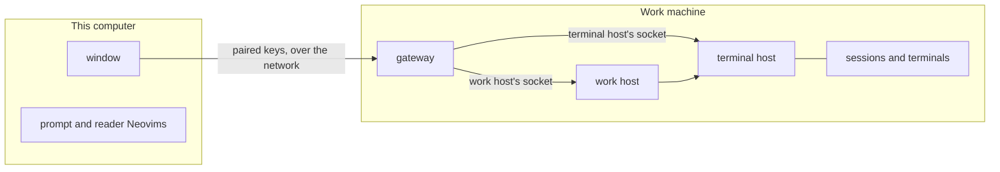

# Remote hosts

The work and terminal hosts can run as independent services on a work machine
([the hosts](sessions.md#the-hosts)): `adroit remote daemon` and
`adroit remote host`, with `--instance <name>` selecting their instance, the
terminal service started before the work service. Each instance has a
persistent identity, and each host incarnation a new private socket that is
never reused. `adroit remote info` describes the currently running pair and
refuses stale discovery. Session commands started in these services discover
the current work host again, so replacing it does not leave them addressing
its previous socket. Replacing the work host leaves the terminal host and its
sessions running; replacing a terminal service ends its sessions, and a
window never replaces it.

`adroit remote enable` registers an instance's terminal host, work host and
gateway as the user's services, launchd agents on macOS and systemd user units
on Linux, so they keep running without a terminal and start again with the
machine; `--listen` and `--no-advertise` are passed to the gateway. Each runs as a service of its
own, so restarting the work host or the gateway leaves the terminal host
running. They start with the PATH the user's login shell had when they were
enabled. Enabling again restarts the services whose PATH or options changed,
starts those that stopped, and leaves the others running. On Linux they run without a
login only when the user has enabled lingering, which `adroit remote enable`
reports rather than changes. `adroit remote disable` stops and removes them.
On macOS, enable them with the `adroit` inside Adroit.app and allow Adroit to
find devices on the local network when macOS asks. macOS keeps a bare
executable started by launchd off the local network: its gateway can still be
reached at its address, but it cannot announce itself. macOS asks only while
someone is at the desktop; when it did not ask, enable the services again
from the desktop.

`adroit connect` checks the selected execution target. It discovers both hosts
and checks their identities and protocols through the paired work machine's
gateway. Closing this diagnostic closes its connection, never the hosts. A
work machine whose key differs from the paired one, and a client key it does
not know, are refused.

## Execution configuration

Each client instance reads `execution.toml` in its own state folder. An absent
file selects local execution. An invalid file is an error, not a request to
use local execution.

[Environments](environments.md) group a connection with its agents and work
settings. The environment menu opens another environment without redirecting
the current instance or requiring the application to restart. The
Environments window checks connections and explains work-machine setup.
Existing execution files remain readable for legacy clients; an environment
binding takes precedence.

Work settings received from a host belong to the selected environment. Remote
paths cannot be opened by local file tools, and remote account login must be
performed on the work machine. Display and input preferences and the embedded
prompt and reader Neovims stay on the client computer.

`backend` is `local` or `native`. A local target has no other fields.
A native target names a paired work machine by `address`, a host name or IP
address with its port, and `server`, the lower-case hexadecimal SHA-256
fingerprint of the work machine's key; the profile `adroit connect pair` adds
holds both. Unknown backends and fields are errors.

```toml
backend = "native"
address = "ai-box.local:47130"
server = "3f5c0e9a4d1b7c2e8f6a5d3b9c0e1f2a4b6c8d0e2f4a6b8c0d2e4f6a8b0c2d4e"
```

## The remote window

Each environment a window shows uses its own work machine for its work,
filesystem and programs. The window never starts a local host to replace an
unavailable remote one.
The connection state remains visible, including how old the displayed work
is during a disconnect, on each environment's heading. A connection that
keeps failing is reported in the status line once, naming its environment
while the window shows several. Reconnection preserves the terminal host's identity;
a replacement terminal host requires opening a new connection explicitly.

Prompts are sent from an open session or draft. Before sending, the window
retains the full draft durably and stops editing the prompt of that
environment's tabs until the outcome is handled. A confirmed send clears only matching text and attachments;
newer drafts are preserved. A lost answer leaves the original draft available
for inspection and recovery. Restarting the window queries the original
operation rather than sending it again.

A remote window types into its consoles while it is connected. Keys typed
before a connection is lost never reach a program after it reconnects.
Local file viewers, external editors, revealing remote paths in Finder,
login terminals and attachments supplied as local file paths are
unavailable for its files; those of an environment on this computer that the
same window shows still open locally. Image data
pasted into the prompt is stored on the work machine. Native session,
terminal and MCP commands run on the work machine; the client machine
refuses them when a work machine is selected.

## Paired work machines



`adroit remote gateway` on the work machine lets paired clients reach the instance's hosts over the
network, on every interface at port 47130 unless `--listen` names an address.
It never starts, stops or replaces a host, and it keeps serving across a
replaced work host.

To pair, run `adroit connect pair <address>` on the client. On the work
machine, run `adroit remote pair` and type the code the client shows once its
request appears. The client then has an environment for the work machine.
The Environments window does both sides: on the client, pairing a work machine lists
the work machines announced on the local network and shows the code; on the
work machine, Accept connections turns the services on and off, chooses
whether the gateway announces itself, allows pairing, takes the code for each
request, and lists and revokes the paired clients. Turning it on is done once
the gateway answers; when the gateway does not start, the window says what it
reported. Turning it off stops what paired clients started there and leaves
the machine's own work running. Every window manages the same services, those of the default
instance, since a machine serves one gateway on its port. A machine can pair
with its own gateway like with any other.

Pairing stays open for a limited time and closes once a client has paired.
Until the work machine allows pairing, the client says so and keeps asking;
it shows its code once the operator can see the request. The operator sees
one request per client: a client asking again replaces its request, and one
that stopped asking leaves the list. A client already paired is shown as such,
and pairing it again keeps it paired. A wrong code pairs nothing, and the
client asks again with a new code. Neither machine sends the code over the
network.

A paired work machine is known by its key, not its address: it stays the same
machine when its address changes, and another machine at its address is
refused. The client keeps one key for all its instances.

The gateway announces itself on the local network with mDNS, under a name
that includes the work machine's host name, unless it was started with
`--no-advertise`. `adroit connect discover` lists the work machines heard,
with an address to pair with. When a paired work machine cannot be reached
with its key at the saved address, the client looks for that key on the
local network and connects where it is announced. An announcement is never
trusted by itself: the key is still proved. The gateway's log says when its
announcement cannot leave the machine, and again once it can.

`adroit remote devices` lists the paired clients, and `adroit remote revoke`
forgets one by the start of its fingerprint and ends its open connections.
Work it already started keeps running. The gateway's log records each pairing
and revocation. A paired client uses the hosts with the
authority of the user the work machine runs as; the gateway only refuses
requests to manage the work host itself, such as stopping it, and closes the
connection that sent one.

## Changes across a lost connection

A remote work host admits changes by an ID bound to its instance and both
hosts' incarnations. Repeating the same ID and payload does not repeat the
change; changing its payload is refused. A client can ask for the outcome
without applying the change again. An accepted change may still finish after
its caller stops waiting.

An outcome can become unknown after retention expires or a host is replaced.
An old ID cannot be reused to apply that change again. An unknown outcome
requires checking the work before initiating another change. A remote CLI
command that loses its answer reports uncertainty and does not retry it.

The window shows retained operations that need attention. Checking an
outcome only queries it. A known failure can restore its draft; a confirmed
send can clear its matching draft. An unknown outcome requires explicitly
checking the work and choosing whether the prompt was sent or should be
restored. Resolving an outcome never reapplies its operation.

Restoring an unsent draft keeps a durable local copy, including drafts whose
tabs do not outlive the window. Saved copies remain available across window
restarts until explicitly deleted or until the matching prompt's confirmed
send has been handled. Restoring a copy preserves a different draft already
in its tab.
