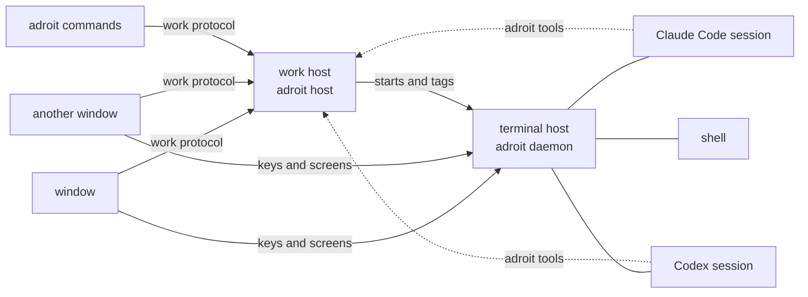

# Sessions

Every session Adroit starts, and every terminal, runs in a host of Adroit's
own, not in the window ([the hosts](#the-hosts)). Closing the window leaves
them running, their scrollback kept; opening it again lists them as they are
and shows each one from where it stands, starting with what it showed when it
closed, if that still runs.

## Agents

A session runs Claude Code, Codex CLI, Pi or OpenCode in its own terminal interface. Each
session is given its profile, and with it its agent and login
([settings](settings.md#profiles)), while it is still a
draft, before its first prompt is sent. The empty window and drafts offer
the profile alone, which decides the agent: every profile, and Adroit's own
for an agent that has none, so every agent can be started. Each is named by
its agent and its name, as a running session's details name it, with a mark
when it has a login of its own. `session.profile_next` and
`session.profile_prev` switch the profile. What is chosen, by the form or by
key, is what new sessions start with while the window is open. Reopening the
app starts with the default profile, which Settings sets on the profile's page.

The draft also offers a model and permissions for that launch. Changing the
profile keeps its prompt and attachments, and keeps the model
and permissions while the agent stays the same; to another agent they go
back to the defaults of the profile chosen, and the status line says so. The
empty window offers them too, and the next new session starts with what was
chosen there. The usage, the `/` commands and the history a draft offers are
those of its profile's login. A session keeps its agent and
profile once it runs, whatever the default becomes. Every kind can run in
the same workspace.

A draft whose profile's program says, in the profile's login, that it
is not logged in offers to open the login terminal
([settings](settings.md#agent-setups-in-the-settings-window)), which runs that
program, and asks again once that terminal ends or, while it is open, when
asked to or cancelled; one whose program cannot be found says so. However
it is started, from a draft, `adroit session start` or another session, a
session is refused before anything is recorded or runs when its profile is
not defined, when its login's folder cannot be made, or
when its agent's program is not found where it is started without a shell;
the refusal says what to do about it.

A session also keeps the profile it started from, and the login it runs
in ([settings](settings.md#profiles)), whatever the
settings say since, and after the work host starts again: messages are
handed to it, its conversation, history and processes are read, and its
starting dialogs are answered, as the settings it was started with say. The
tree and the strip of a window showing it name the session's agent and,
when it is called otherwise, its profile; the details name its profile and
its login. A profile deleted since is named as it was called when the
session started.

A read-only Claude Code session loses its file-editing tools and runs its
shell commands in Claude Code's sandbox, which keeps them from writing to its
directory or the repository's history; the user's and the repository's Claude
Code settings cannot loosen this. Where that sandbox cannot run, the session
fails to start.

Codex sessions use the embedded prompt and report their working and waiting
states through the terminal, including permission and question prompts. Their
output stays in the terminal scrollback for scrolling and reading in Neovim. A
read-only Codex session uses the read-only sandbox. Codex's own configuration
controls authentication; Adroit can override its model, reasoning effort,
approvals and sandbox for each launch. Claude's model,
permission mode and denied tools do not apply to Codex.

Codex sessions started by Adroit list their conversation's artifacts, images,
links and files in the [Resources sheet](details.md). The list follows the current
conversation, including after switching conversations in Codex.
For a Codex session already running when Adroit was updated, run
`/title app-name thread-id` in Codex to enable the Resources sheet.

Codex prompt history in the embedded prompt is not available. Codex menus, approvals and questions take keys
directly while they are open. Use Codex's own interface for its commands and
menus:
`Ctrl-g i` passes keys through until `Esc`. Renaming in Adroit changes the
Codex session's name in the tree only. A message with a leading `!` is pasted into
Codex as it was written, so what Codex does with it is up to Codex.

Pi sessions use the embedded prompt too, and their output stays in the
terminal scrollback. Pi asks before no tool call and has no sandbox, so what
a Pi session may do is the tools it is given: a read-only one is given only
those that read files and none that run commands or write; custom
permissions for Pi name its tools. Either way it keeps Adroit's own. A
session given its shell tool can run any command its user can. Pi has no
account usage to show. Adroit can override its model, as `provider/id`,
its thinking level and its tools for each launch. Pi asks whether to trust a
project's own files before its interface starts; the session shows it as
waiting on you, and shows Pi's login dialog as waiting on a login.

Pi sessions list their conversation's links and files in the Resources sheet, and
follow the conversation the session moves to with `/new` or `/resume`. Their
prompt history is the prompts sent in the session's directory, as Pi keeps
them. Renaming in Adroit renames the Pi session with `/name`, and a message
with a leading `!` runs as a shell line in Pi.

OpenCode sessions use the embedded prompt too. Adroit runs OpenCode 2.1 or
later, the `@opencode/cli` package, and refuses to start a session of an older
release, saying how to install a newer one. Each session runs with a server of
its own, which no other session or terminal shares, and starts on a
conversation whose id Adroit chooses; OpenCode makes it once its first prompt
is sent. OpenCode asks as its permission rules say and has no sandbox, so
what an OpenCode session may do is the agent it runs as and its rules: a
read-only one is set to its plan agent, may use only the tools that read as
any agent it starts as, and reads no configuration of the repository's; no
other configuration's rules widen it, though the plugins and MCP servers the
account's own configuration names still run;
custom permissions for OpenCode name its agent, its rules and whether it
approves on its own. Either way Adroit's own tools stay allowed. A session
allowed its shell tool can run any command its user can. OpenCode has no
account usage to show. Adroit can override its model, as `provider/model`,
for each launch. A permission OpenCode asks for shows the session as waiting
on you.

OpenCode sessions list their conversation's links and files in the Resources
sheet, read through OpenCode itself. A message with a leading `!` runs as a shell
line in OpenCode.

## Instances

Adroit runs as named instances, each with its own hosts and sessions, apart
from the others. `adroit --instance <name>` opens a window of the instance
`name`, as does `adroit` with `$ADROIT_INSTANCE` set; without either it is
the instance `default`. A name is made of letters, digits, `-` and `_`, up to
32 of them.

The sessions and terminals of an instance, and the commands run in them,
belong to it: they see only its sessions and terminals, and the sessions they
start are its own. Settings and keys are the same in every instance.

## Windows

Opening Adroit while a window of the instance is open brings that window to
the front instead, the one opened first when there are several. New Window
(`window.open`), or `adroit --new-window` with or without `--instance`,
opens another window of the instance. The windows of other instances open
beside them.

Every window of an instance shows the same work: a session or a terminal
started, ended or renamed in one is seen in the others. How a window shows
it is its own: the tree's folds, selection and filter, the content's tabs and
windows, the panels, the details, the picker, and the prompt. Closing a window
leaves the others as they are, and the sessions run on with no window open.

Each window holds a number, the lowest none of the instance's open windows
holds. A window keeps, under its number, the layout of its side panels and
its content when it closed ([content](content.md#across-runs)), and the next window opened
with that number shows them again. Windows are not opened again together:
opening Adroit opens one, and each New Window the next.

### The window sockets

Each window answers the editor handoff and foreground requests on a socket
of its own, in `$ADROIT_WINDOWS`, or the `windows` folder of its instance's
state folder. These requests do not control sessions or terminals.

Claude Code's external editor uses `adroit editor <file>` to hand over its
input. Every agent session Adroit starts, from the window, from
`adroit session start` or by another session, names it as `$VISUAL` and
`$EDITOR`, keeping the user's own editor in `$ADROIT_USER_EDITOR`; every
terminal keeps the user's editor. A window asks for the input only of a
session started this way, and `adroit editor` offers the file to each window
of the instance in turn, so the input reaches the window that asked for it. A
JSONL request `{"op":"editor","path":"/tmp/prompt.md"}` receives
`{"taken":2}` when two lines were taken, or `"declined"` when the window did
not ask for the input. A file every window declines opens in
`$ADROIT_USER_EDITOR`. `{"op":"show"}` brings the window to the front and
receives `"shown"`.

## The hosts

Two processes of Adroit's own run each instance's work, apart from the
windows, and keep running when they close.

- The terminal host, `adroit daemon`, holds every session's and terminal's
  pseudo-terminal, and nothing else. It listens on `$ADROIT_DAEMON`, or
  `$XDG_STATE_HOME/adroit/felis/daemon.sock` for the default instance and
  `$XDG_STATE_HOME/adroit/instances/<name>/felis/daemon.sock` for another
  (`$XDG_STATE_HOME` being `~/.local/state` when unset). Windows send it keys
  and draw its screens directly ([terminal protocol](terminal-protocol.md)).
- The work host, `adroit host`, holds the work: it starts and lists every
  session and terminal, reads the files, repositories and settings the windows
  show, keeps what is written in the prompts, lets sessions open and message
  sessions ([sessions that open sessions](opening-sessions.md)) and judges how each
  session it started stands. It listens on `$ADROIT_HOST`, or
  `host/host.sock` in the same state folder as the terminal host's `felis`
  folder. Windows and the `adroit` commands reach it there
  ([work protocol](work-protocol.md)).

The folder of either socket has to be yours and open to no one else: Adroit
makes it so when it makes the folder, and refuses one already there that is
not, leaving it as it is.

A window works with a host whenever they share a version of its protocol,
whichever build of Adroit either is, so an update of Adroit that leaves the
protocols alone asks nothing of the user. The window starts the work host of
its instance when none answers, and the work host starts the terminal host.
A work host the window cannot work with, or one of another build, the window
replaces without asking; nothing ends with it. A terminal host the window
cannot work with the window never replaces on its own: it shows a banner
offering to restart it, with the build the host says it is.

`adroit daemon stop` stops the terminal host of the instance and waits until
its process is gone; `adroit daemon restart` stops it, if one runs, and starts
another. Either ends every session and terminal the terminal host holds, with
what they scrolled back. A terminal host too old to be asked to stop is
stopped by signal. `adroit host stop` and `adroit host restart` do the same
for the work host, and end no session. Stopping where no host runs is not an
error.

The window restarts the terminal host with Restart Session Daemon
(`daemon.restart`), only after the user confirms that every session ends.

The hosts and session commands can be built without the desktop window. That
build never opens a window, and refuses the window's editor integration. Its
sessions and terminals have the same lifetime as those started by the desktop
build. On a work machine the hosts run as services
([remote hosts](remote-execution.md)).

A session ends when its program exits or when it is ended from Adroit. Its
console then says so, and it is listed no more.

## Resuming a past conversation

Claude Code, Codex, Pi and OpenCode keep each conversation after its
session ends, and Adroit lists only the sessions it runs. Resume Conversation in the Session
menu, or `session.resume`, opens a list of the conversations the agents kept,
in every login a profile runs in,
for the directory the focused window works in, the newest first, each with its
agent and profile, marked when it is kept in a login of the profile's own,
its title or first prompt, its directory and when it was
last talked in. `Ctrl+a` lists those of every directory instead, and pressed again only
the directory's; with nothing open, every directory's are listed. Typing
narrows the list by a fuzzy match on the title and the directory. `Ctrl+n`
and `Ctrl+p` (or the arrow keys, `Tab` and `Shift+Tab`) move, `Enter` chooses,
and `Escape` closes the list.

Choosing a conversation resumes it in a new session of its agent, in the
directory it ran in, with the agent's own resume, in the login that
keeps it and from the profile that runs there; when the settings no longer
hold that profile with that login, the resume is refused, naming why,
and never runs under another login. Nothing running is stopped
or changed. A conversation a session of this instance already holds is not
resumed a second time: choosing it shows that session.

Conversations no one wrote a prompt in, and those Codex ran without its own
interface, are not listed.

## Opened by a session

A session can open sessions beside it and talk with other sessions, and
`adroit session start` starts one from a terminal
([sessions that open sessions](opening-sessions.md)).

## Keeping the Mac awake

While a session or a shell runs, the window open or not, the Mac does not go
to idle sleep, so they go on with no one at it; the display still sleeps as
the Energy settings say. Closing the lid on battery, sleeping it by hand and
the system's own emergencies still sleep it. `pmset -g assertions` lists what
keeps it awake under Adroit's name. Within seconds of the last one ending, or
of `keep_awake` being turned off in the [settings](settings.md), the Mac
sleeps when idle again.

## How a session stands

The state a session shows, working, waiting on you and for what, done or
failed, is what its program reports with the
[OSC 7501 program status protocol](https://www.superlogical.com/rex/docs/build/program-status),
as the daemon keeps it. When Codex, Pi or OpenCode reports no status, its visible activity and
requests for approval or input supply the state instead. A session Adroit
started shows as starting until its program reports a state or its visible
activity supplies one.

A session whose turn has finished is marked done, with a check, in the tree
and in the strip of a window showing it, until it is viewed in this window;
viewed, it shows as idle. A later turn finished out of view is marked done
again. A window in the background views nothing, so its marks stay.

## Renaming a session

Double-clicking a session's name in the tree or its tab edits that name
in place. The rename action from the keyboard or menu opens the same editor.
Enter or leaving the field accepts the name; Escape cancels. An empty or
unchanged name leaves the session's name as it was.
